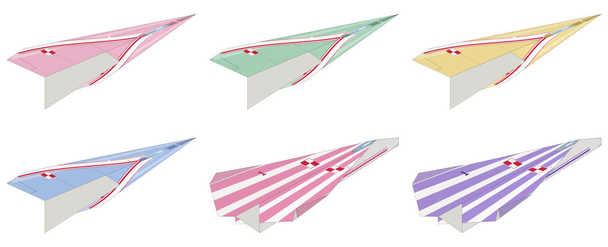

# Papierowe samoloty – sekcja domowydrukarz.pl

Sześć samolotów do wydrukowania na jednej stronie A4 (80 g, druk jednostronny).
Linie zgięć są wtopione w malowanie, a wzór jest rozłożony tak, żeby po złożeniu
trafił dokładnie na skrzydła, kadłub i winglety.


| # | Model | Trudność | Kartka | Malowanie | Lot |
|---|-------|----------|--------|-----------|-----|
| 1 | **Grot** | ●○○ | pionowo | myśliwiec w kamuflażu z szachownicą | szybka klasyczna strzała |
| 2 | **Iskra** | ●○○ | poziomo | biało-kolorowy samolot szkolno-akrobacyjny | szeroka delta, kilka zgięć |
| 3 | **Albatros** | ●●○ | poziomo | biały szybowiec z kolorowymi paskami | wolny, długi lot w domu |
| 4 | **Jerzyk** | ●●○ | poziomo | liniowiec fikcyjnych linii JERZYK | ciężki nos, na dwór |
| 5 | **Sokół** | ●●● | pionowo | myśliwiec z przednimi skrzydełkami, dwubarwny kamuflaż | przednie skrzydełka, stabilny |
| 6 | **Bryza** | ●●● | pionowo | dwusilnikowy samolot patrolowy | zablokowany tępy nos, do pokoju |

Wszystkie malowania są lotnicze. Żaden model nie wymaga nożyczek ani kleju.

Składanie to tradycyjne, przekazywane od pokoleń bazy (strzałka, „bomba wodna”,
nos zwijany, delta, układ z przednimi skrzydełkami). Geometria jest narysowana od nowa pod A4.
Nie kopiujemy szablonów z książek. Nazwy modeli są nasze.

## Strona narzędzia

`strona/index.html` to gotowe narzędzie w stylu domowydrukarz.pl (te same style, pasek, przełącznik motywu,
stopka; własny kolor narzędzia: `.k-samoloty{--k:#5F7A14;--kn:#A9C653}` do karty na stronie głównej).
Wszystko jest w jednym pliku: pdf-lib, dane modeli i skrypt, więc działa bez internetu.

- wybór modelu z miniaturami, podgląd złożonego samolotu (z góry, od spodu, arkusz) i lupa z kropkami w skali 1:1,
- **kolor główny do wyboru**: 10 próbek albo dowolny kolor. Wzór zostaje, zmienia się kolor (np. różowa strzała),
- **bez malowania**: same linie zgięć i numery kroków (`?malowanie=0`), do kolorowania kredkami,
- PDF składany w przeglądarce (pdf-lib), opcjonalnie z instrukcją na drugiej stronie,
- kroki składania rysowane na żywo w wybranym kolorze,
- **bez drukarki**: kroki składania z wymiarami w cm od rogów kartki, do złożenia zwykłej kartki A4;
  szablon do pobrania jako PDF (na telefon), na stronie przełącznik „Bez drukarki, z wymiarami” (`?drukarka=0`),
- model i kolor są w adresie strony (`?model=grot&kolor=e2508c`).



## Kropki zamiast jednolitego koloru

Kolorowe pola są drukowane rastrem kropek co 1 mm (siatka heksagonalna). Z odległości ręki
zlewają się w jasny odcień, a tuszu jest kilka razy mniej niż przy pełnej apli. Dla drukarek
atramentowych na zwykłym papierze 80 g to różnica między płaską kartką a pofalowaną.
W PDF każdy rząd kropek to jedna linia z kreską o zerowej długości i okrągłym zakończeniu,
więc plik waży kilkadziesiąt KB.

## Pliki

W katalogu `wyniki/<model>/`:

- `<model>.pdf` – strona 1 to arkusz do druku (wektor, kolor naturalny), strona 2 to instrukcja krok po kroku,
- `<model>-tylko-wydruk.pdf` – sam arkusz,
- `<model>-same-linie.pdf` – arkusz bez malowania, same linie zgięć,
- `<model>-podglad.png`, `<model>-spod.png` – podgląd złożonego modelu (z góry i od spodu),
- `<model>-arkusz.png` – podgląd arkusza.

Pliki zbiorcze:

- `wyniki/wszystkie-arkusze.pdf` – sześć arkuszy w jednym pliku,
- `wyniki/modele.json` – podsumowanie modeli,
- `wyniki/dane/<model>.json` – dane dla strony: arkusz jako lista operacji wektorowych z kolorem-rolą,
  sceny podglądu 3D i schematy kroków,
- `strona/index.html` – narzędzie na stronę (generuje je `src/strona.py`).

## Jak drukować

- Drukuj **tylko stronę 1**, jednostronnie, na A4 80 g.
- Skala **100% / „rozmiar rzeczywisty”**. Wyłącz „dopasuj do strony”, bo inaczej linie zgięć
  rozjadą się z krawędziami kartki.
- Domowe drukarki zostawiają 3–5 mm białego marginesu. Na krawędziach skrzydeł wychodzi
  wtedy cienki biały brzeg. Kto ma druk bez marginesów, niech go włączy.
- Na niektórych częściach samolotu widać spód kartki, którego nie drukujemy (zwykle spód
  kadłuba i część spodu skrzydeł). Malowanie jest pod to zaprojektowane: biały spód należy do wzoru.
- Malowania są projektowane pod **drukarki atramentowe**. Nie ma dużych pełnych apli,
  tła to jasne odcienie, a detale są rysowane kreską. Zwykła kartka 80 g nie powinna się
  pofalować. Generator mierzy pokrycie tuszem i ostrzega, gdy średnia przekracza 15%
  albo jakieś pole 30×30 mm przekracza 50% (wartości dla modeli są w `wyniki/modele.json`).
- Napisy, oczy, znaki i logo stawiane są automatycznie tylko tam, gdzie zmieszczą się
  w całości na jednym ciągłym kawałku kartki: co najmniej 2,5 mm od zgięć i 5 mm od brzegu
  kartki (margines drukarki). Generator ostrzega o każdym detalu, który mógłby zostać ucięty.
- Napis `domowydrukarz.pl` stoi w miejscu, które po złożeniu jest całkowicie schowane
  w środku modelu (z zapasem 7 mm na niedokładne składanie).

## Jak to działa

`src/` zawiera mały symulator składania kartki:

- `fold.py` – płaskie zginanie warstw: każda ścianka pamięta swój kształt na kartce,
  przekształcenie do stanu złożonego i kolejność warstw. Linie zgięć z każdego kroku
  są automatycznie przenoszone z powrotem na kartkę.
- `model3d.py` – złożenie skrzydeł i wingletów na zawiasach w 3D. Dla każdego panelu
  liczy, który fragment kartki jest widoczny (wierzch i spód stosu) i od której strony.
- `render.py` – malowanie arkusza: wzór jest projektowany w układzie gotowego samolotu
  (widok z góry, z dołu, z boków). Każdy widoczny fragment kartki dostaje swój kawałek
  wzoru przez odwrotne przekształcenie, ze spadem 3 mm. Tu powstają też schematy kroków
  i podgląd 3D.
- `models/*.py` – definicje modeli: kolejne zgięcia, zawiasy skrzydeł i malowanie.
- `export.py` – zapisuje arkusz jako listę operacji (ścieżki, wypełnienia, kreski, rastry kropek) z kolorem
  głównym jako rolą, którą przeglądarka podmienia,
- `web/samoloty-core.js` – rysuje te dane na canvasie i składa PDF przez pdf-lib; tego samego kodu
  używa Node przy budowaniu PDF-ów w repo (`web/pdf-node.js`),
- `web/app.js` – logika strony, `web/dd/` – style i elementy skopiowane z domowydrukarz.pl,
- `build.py` – generuje dane, PDF-y i podglądy; `strona.py` – składa stronę.

Narzędzia pomocnicze:

- `debug.py <moduł> <Klasa> <prefiks>` – podgląd kroków i 3D jednego modelu,
- `experiment.py` – porównanie orientacji kartki (nadruk w górę/w dół, kierunek złożenia na pół)
  pod kątem widocznej powierzchni nadruku,
- `linevis.py` – sprawdza, czy linia danego kroku jest widoczna w chwili zginania,
- `views.py <katalog> <moduł:Klasa> ...` – mapa widoków (góra, spód, boki): co widać,
  gdzie są białe pola spodu kartki, zielone kontury bezpiecznych stref na detale;
  wypisuje też pokrycie tuszem i ucięte detale,
- `strona.py` – odświeża `strona/index.html`.

Wymagania: Python 3 (`pip install shapely numpy scipy pillow cairocffi pymupdf`) i Node.js.

```sh
cd papierowe-samoloty/src
python3 build.py            # wszystkie modele
python3 build.py bryza      # jeden model
python3 strona.py           # strona/index.html
```

Aby zmienić malowanie, edytuj metodę `art()` w pliku modelu. Kolor główny modelu to `inks["main"]`;
w malowaniu używaj `self.c(k)` (kolor główny przyciemniony o k) i `self.dots(pokrycie)` (raster kropek),
żeby wybór koloru na stronie działał. Rysujesz w milimetrach
w układzie gotowego samolotu: `top` (X do przodu, Y w lewo), `bottom`, `left`, `right`.
Resztę, czyli rozłożenie wzoru na kartkę, robi symulator. Napisy wstawiaj przez
`self.label(...)`, a inne detale przez `self.fit(...)`. Obie funkcje same znajdują najbliższe
miejsce, w którym detal nie zostanie przecięty zgięciem ani marginesem.

## Do sprawdzenia na papierze

Symulacja to nie składanie. Przed publikacją każdy model trzeba wydrukować i złożyć.
Najbardziej niepewne są:

- **Bryza**: krok z klapkami po „bombie wodnej”. W symulacji klapki wchodzą pod nos. Na papierze
  może trzeba przesunąć linię o kilka mm.
- **Iskra**: zagięcie czubka nosa (linia 5) jest krótkie – sprawdzić, czy wystarcza do wyważenia.
- **Sokół**: kąt odgięcia przednich skrzydełek (krok 4–5).
- **Jerzyk**: trzykrotnie zwijany nos jest gruby. Jeśli linie 4–5 nie trafiają, wystarczy
  zwinąć dwa razy.

Poprawki robi się zmianą liczb w `models/<model>.py` i ponownym `python3 build.py`.
