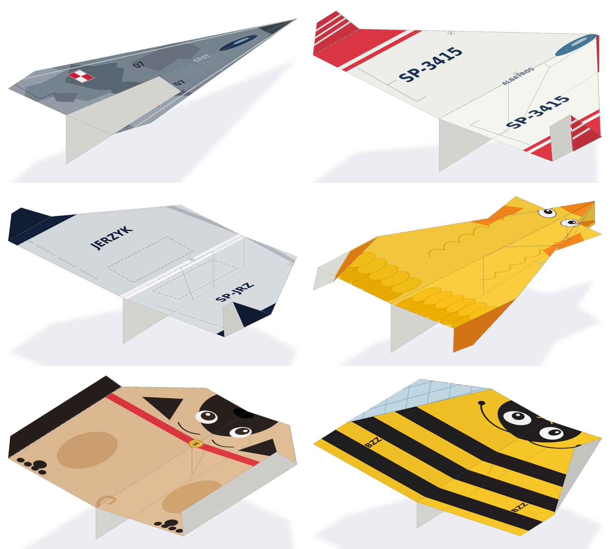

# Papierowe samoloty – sekcja domowydrukarz.pl

Sześć samolotów do wydrukowania na jednej stronie A4 (80 g, druk jednostronny).
Linie zgięć są wtopione w malowanie, a wzór jest rozłożony tak, żeby po złożeniu
trafił dokładnie na skrzydła, kadłub i winglety.



| # | Model | Trudność | Kartka | Malowanie | Lot |
|---|-------|----------|--------|-----------|-----|
| 1 | **Grot** | ●○○ | pionowo | realistyczny – myśliwiec w szarym kamuflażu z szachownicą | szybka klasyczna strzała |
| 2 | **Albatros** | ●●○ | poziomo | realistyczny – biały szybowiec z czerwonymi końcówkami | wolny, długi lot w domu |
| 3 | **Jerzyk** | ●●○ | poziomo | realistyczny – liniowiec fikcyjnych linii JERZYK | ciężki nos, na dwór |
| 4 | **Kaczka** | ●●● | pionowo | kreskówkowy – żółte kaczątko | przednie skrzydełka, stabilny |
| 5 | **Mops** | ●●● | pionowo | kreskówkowy – mops z czarną mordką | zablokowany tępy nos, do pokoju |
| 6 | **Trzmiel** | ●●● | pionowo | kreskówkowy – puchaty trzmiel | duże winglety, trzyma kurs |

Składanie to tradycyjne, przekazywane od pokoleń bazy (strzałka, „bomba wodna”,
nos zwijany, kaczka z przednimi lotkami). Geometria jest narysowana od nowa pod A4.
Nie kopiujemy szablonów z książek. Nazwy modeli są nasze.

## Pliki

W katalogu `wyniki/<model>/`:

- `<model>.pdf` – strona 1 to arkusz do druku (wektor), strona 2 to instrukcja krok po kroku,
- `<model>-tylko-wydruk.pdf` – sam arkusz,
- `<model>-podglad.png`, `<model>-spod.png` – podgląd złożonego modelu (z góry i od spodu),
- `<model>-arkusz.png` – podgląd arkusza.

Pliki zbiorcze:

- `wyniki/wszystkie-arkusze.pdf` – sześć arkuszy w jednym pliku,
- `wyniki/modele.json` – dane do strony,
- `strona/index.html` – gotowa sekcja galerii z linkami do PDF-ów.

## Jak drukować

- Drukuj **tylko stronę 1**, jednostronnie, na A4 80 g.
- Skala **100% / „rozmiar rzeczywisty”**. Wyłącz „dopasuj do strony”, bo inaczej linie zgięć
  rozjadą się z krawędziami kartki.
- Domowe drukarki zostawiają 3–5 mm białego marginesu. Na krawędziach skrzydeł wychodzi
  wtedy cienki biały brzeg. Kto ma druk bez marginesów, niech go włączy.
- Na niektórych częściach samolotu widać spód kartki, którego nie drukujemy (zwykle spód
  kadłuba i część spodu skrzydeł). Malowanie jest pod to zaprojektowane: biały spód należy do wzoru.
- Napis `domowydrukarz.pl` stoi w miejscu, które po złożeniu jest całkowicie schowane
  w środku modelu (z zapasem 7 mm na niedokładne składanie).

## Jak to działa

`src/` zawiera mały symulator składania kartki:

- `fold.py` – płaskie zginanie warstw: każda ścianka pamięta swój kształt na kartce,
  przekształcenie do stanu złożonego i kolejność warstw. Linie zgięć z każdego kroku
  są automatycznie przenoszone z powrotem na kartkę.
- `model3d.py` – złożenie skrzydeł i wingletów na zawiasach w 3D. Dla każdego panelu
  liczy, który fragment kartki jest widoczny (wierzch i spód stosu) i od której strony.
- `render.py` – malowanie arkusza: wzór jest projektowany w układzie gotowego samolotu
  (widok z góry, z dołu, z boków). Każdy widoczny fragment kartki dostaje swój kawałek
  wzoru przez odwrotne przekształcenie, ze spadem 3 mm. Tu powstają też schematy kroków
  i podgląd 3D.
- `models/*.py` – definicje modeli: kolejne zgięcia, zawiasy skrzydeł i malowanie.
- `build.py` – generuje wszystkie PDF-y i podglądy.

Narzędzia pomocnicze:

- `debug.py <moduł> <Klasa> <prefiks>` – podgląd kroków i 3D jednego modelu,
- `experiment.py` – porównanie orientacji kartki (nadruk w górę/w dół, kierunek złożenia na pół)
  pod kątem widocznej powierzchni nadruku,
- `linevis.py` – sprawdza, czy linia danego kroku jest widoczna w chwili zginania.

Wymagania: Python 3, `pip install shapely numpy pillow cairocffi pymupdf`.

```sh
cd papierowe-samoloty/src
python3 build.py            # wszystkie modele
python3 build.py mops       # jeden model
```

Aby zmienić malowanie, edytuj metodę `art()` w pliku modelu. Rysujesz w milimetrach
w układzie gotowego samolotu: `top` (X do przodu, Y w lewo), `bottom`, `left`, `right`.
Resztę, czyli rozłożenie wzoru na kartkę, robi symulator.

## Do sprawdzenia na papierze

Symulacja to nie składanie. Przed publikacją każdy model trzeba wydrukować i złożyć.
Najbardziej niepewne są:

- **Mops** i **Trzmiel**: krok z klapkami po „bombie wodnej”. W symulacji klapki wchodzą
  pod nos (Mops) albo leżą płasko (Trzmiel). Na papierze może trzeba przesunąć linię o kilka mm.
- **Kaczka**: kąt odgięcia przednich skrzydełek (krok 4–5).
- **Jerzyk**: trzykrotnie zwijany nos jest gruby. Jeśli linie 4–5 nie trafiają, wystarczy
  zwinąć dwa razy.

Poprawki robi się zmianą liczb w `models/<model>.py` i ponownym `python3 build.py`.
